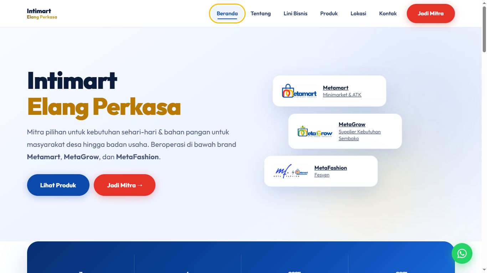
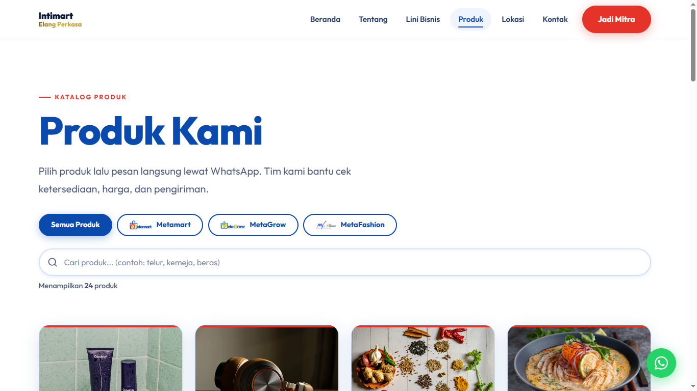
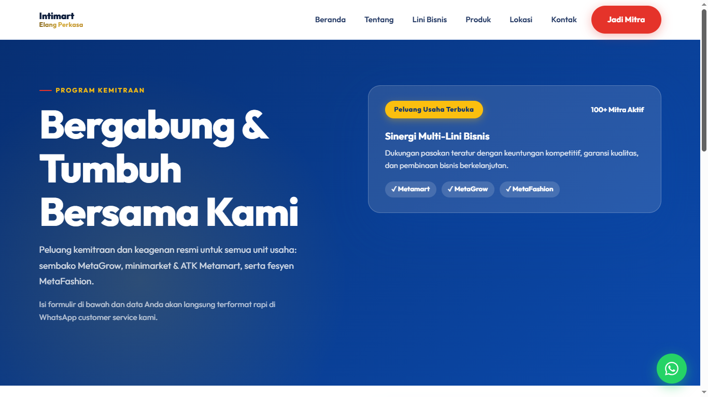

<div align="center">


# PT Intimart Elang Perkasa
### Company Profile Website

[](https://vercel.com)
[](https://react.dev)
[](https://vite.dev)
[](https://animejs.com)

**Website company profile modern untuk PT Intimart Elang Perkasa — bagian dari I.W. Group**

[🌐 Live Demo](https://intimart.vercel.app) · [📧 Kontak](mailto:ptintimartelangperkasa@gmail.com) · [💬 WhatsApp](https://wa.me/6285788485400)

</div>

---

## 📸 Preview Tampilan

### 1. Halaman Beranda (`/`)
> *Desain hero modern sesuai company profile, statistik interaktif count-up, lini bisnis, dan daftar mitra resmi.*

<div align="center">
  
</div>

<br/>

### 2. Katalog Produk & Pencarian Real-Time (`/produk`)
> *Katalog produk terstruktur dengan filter kategori per lini bisnis, pencarian instan, dan integrasi WhatsApp.*

<div align="center">
  
</div>

<br/>

### 3. Halaman Program Kemitraan (`/mitra`)
> *Formulir kemitraan multi-lini bisnis dengan validasi interaktif dan direct template WhatsApp.*

<div align="center">
  
</div>

---

## ✨ Fitur

- 🎨 **Desain Modern** — UI premium dengan glassmorphism, gradient, dan micro-animations menggunakan anime.js
- 📱 **Fully Responsive** — Tampil sempurna di semua perangkat (mobile, tablet, desktop)
- ⚡ **Performa Tinggi** — Code splitting, lazy loading, dan WebP images yang dioptimasi
- 🔍 **Pencarian Produk** — Filter dan search real-time di halaman produk
- 🗺️ **Google Maps Terintegrasi** — Lokasi kantor dengan embed maps yang estetis
- 💬 **WhatsApp Integration** — Tombol WA float global + pesan otomatis terisi
- ♿ **Aksesibilitas** — Skip navigation, ARIA labels, focus visible, reduced motion support
- 🔐 **SEO Ready** — Meta tags, title dinamis, semantic HTML
- 🎞️ **Animasi Scroll** — Reveal animations menggunakan IntersectionObserver + anime.js
- 📊 **Animated Counters** — Angka statistik dengan animasi count-up

## 🏢 Brand yang Diwakili

| Brand | Kategori | Deskripsi |
|-------|----------|-----------|
| **Metamart** | Minimarket & ATK | Retail kebutuhan sehari-hari, alat tulis & kantor |
| **MetaGrow** | Sembako | Supplier telur, beras, dan bahan pangan pokok |
| **MetaFashion** | Fesyen | Pakaian ex-import berkualitas dan aksesoris |

## 🗂️ Halaman

| Halaman | URL | Deskripsi |
|---------|-----|-----------|
| Beranda | `/` | Hero, statistik perusahaan, lini bisnis, mitra |
| Tentang | `/tentang` | Profil, visi-misi, timeline, tim, legalitas |
| Lini Bisnis | `/bisnis/:slug` | Detail Metamart, MetaGrow, MetaFashion |
| Produk | `/produk` | Katalog produk dengan filter & search |
| Lokasi | `/lokasi` | Google Maps + wilayah layanan |
| Kontak | `/kontak` | Form email + tombol WhatsApp cepat |
| Jadi Mitra | `/mitra` | Formulir kemitraan → WhatsApp otomatis |

## 🛠️ Tech Stack

```
Frontend:    React 18 + React Router DOM v7
Build Tool:  Vite 8
Animations:  anime.js v4
Styling:     Vanilla CSS (custom design system)
Typography:  Outfit Variable (Google Fonts)
Icons:       Inline SVG (zero dependency)
API:         Vercel Serverless Functions (contact form)
```

## 🚀 Menjalankan Lokal

```bash
# Clone repositori
git clone https://github.com/syubidin/intimart-react.git
cd intimart-react

# Install dependencies
npm install --legacy-peer-deps

# Salin environment variables
cp .env.example .env.local
# Edit .env.local sesuai kebutuhan

# Jalankan dev server
npm run dev
# → http://localhost:5173
```

## ⚙️ Konfigurasi

### Environment Variables

Salin `.env.example` menjadi `.env.local` dan isi:

```env
# Email untuk form kontak (opsional)
SMTP_HOST=smtp.gmail.com
SMTP_PORT=587
SMTP_USER=your@email.com
SMTP_PASS=your-app-password
TO_EMAIL=ptintimartelangperkasa@gmail.com
```

### Mengubah Konten

Semua konten utama ada di satu file: **`src/data.js`**

```js
// Kontak
export const CONTACT = { email, address, phones }

// Lini bisnis & produk
export const LINES = [ { slug, name, tag, color, desc, groups } ]

// Tim
export const TEAM = [ { name, role, img } ]

// Mitra
export const PARTNERS = [ ... ]

// Toko/cabang
export const STORES = [ { name, line, address, hours, wa, maps } ]
```

## 🌐 Deploy ke Vercel

### Cara 1: Vercel Dashboard (Recommended)
1. Push kode ke GitHub
2. Login ke [vercel.com](https://vercel.com) → **Import Project**
3. Pilih repo `intimart-react`
4. Tambah environment variables di Settings
5. Deploy otomatis!

### Cara 2: Vercel CLI

```bash
npm install -g vercel
vercel login
vercel --prod
```

### Cara 3: Deploy Button

[](https://vercel.com/new/clone?repository-url=https%3A%2F%2Fgithub.com%2Fsyubidin%2Fintimartreact)

## 📁 Struktur Proyek

```
intimart-react/
├── api/
│   └── contact.js          # Serverless function form kontak
├── public/
│   ├── images/             # Logo, foto produk, tim
│   └── favicon.png
├── src/
│   ├── pages/
│   │   ├── Home.jsx        # Beranda
│   │   ├── About.jsx       # Tentang kami
│   │   ├── Business.jsx    # Detail lini bisnis
│   │   ├── Products.jsx    # Katalog produk + search
│   │   ├── Locations.jsx   # Lokasi + Google Maps
│   │   ├── Contact.jsx     # Form kontak
│   │   └── Partner.jsx     # Formulir kemitraan
│   ├── App.jsx             # Routes
│   ├── components.jsx      # Layout, Navbar, Footer, WA Float
│   ├── data.js             # ⭐ Semua konten situs
│   ├── lib.jsx             # Utilities (Reveal, Count, Field)
│   ├── main.jsx            # Entry point
│   └── styles.css          # Design system CSS
├── index.html
├── vite.config.js
├── vercel.json
└── package.json
```

## 🎨 Design System

Warna utama yang digunakan:

| Token | Hex | Penggunaan |
|-------|-----|-----------|
| `--blue` | `#0b4aad` | Primary, headings |
| `--red` | `#e5332a` | Metamart, CTA buttons |
| `--green` | `#1a9e3a` | MetaGrow, area badges |
| `--yellow` | `#fbbf0f` | Aksen, highlight |
| `--ink` | `#0b1b3a` | Body text |

## 📝 Lisensi

© 2026 PT Intimart Elang Perkasa · I.W. Group. All rights reserved.

---

<div align="center">
Built with ❤️ for PT Intimart Elang Perkasa
</div>
